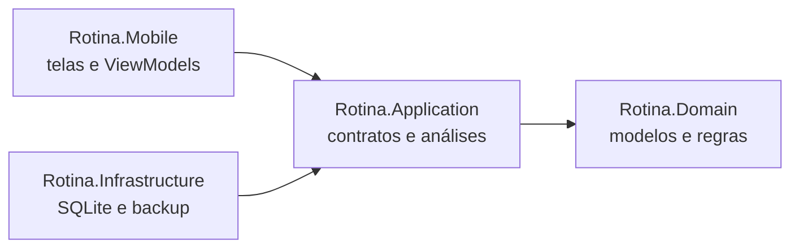

# Rotina

Aplicativo Android para planejar o dia e acompanhar hábitos, tarefas, metas, treinos, foco e evolução pessoal em um só lugar. Os dados ficam no dispositivo e o aplicativo funciona sem conta ou conexão de rede.

> **Estado:** projeto em desenvolvimento. As funcionalidades principais estão implementadas, mas ainda há fluxos que precisam de validação manual antes de uma versão para uso diário.

## O que o aplicativo oferece

- **Hoje:** hábitos, agenda, água, check-in e resumo do dia.
- **Rotina:** hábitos recorrentes, tarefas, compromissos, foco e quadro dos sonhos.
- **Treino:** planos versionados, séries, descanso, histórico e periodização.
- **Progresso:** metas, peso, medidas e gráficos por período.
- **Perfil:** preferências, tema, exportação e backup local.

## Interface

As capturas de desenvolvimento estão na pasta local `artifacts/`, ignorada pelo Git porque podem mostrar dados pessoais. Antes da publicação, adicionar capturas feitas com dados de demonstração em `docs/images/` e incorporá-las aqui. O fluxo sugerido para a galeria é **Hoje → criar hábito → concluir → consultar Progresso**, acompanhado de **Treino → iniciar sessão → registrar série**.

<!-- Substituir por capturas anonimizadas da versão atual:


-->

## Tecnologias

- C# 13 e .NET MAUI 9, com destino Android (`net9.0-android`)
- SQLite via `Microsoft.Data.Sqlite`, com migrações locais
- Injeção de dependências do MAUI e ViewModels para o estado da interface
- xUnit para testes de domínio, aplicação e persistência

## Arquitetura



| Projeto | Responsabilidade |
| --- | --- |
| `src/Rotina.Domain` | Entidades, valores e validações sem dependência da plataforma. |
| `src/Rotina.Application` | Contratos de persistência, datas locais e cálculos de progresso. |
| `src/Rotina.Infrastructure` | Implementação SQLite, migrações, exportação e backup. |
| `src/Rotina.Mobile` | Telas MAUI, ViewModels, navegação e integração Android. |
| `tests/Rotina.Tests` | Testes automatizados, inclusive com SQLite temporário. |

As telas dependem de interfaces da camada Application. A implementação SQLite é fornecida pela composição em `MauiProgram.cs`. O domínio não conhece a interface nem o banco.

## Executar localmente

1. Instale o SDK .NET 9, JDK e Android SDK com a API 35. Instale o workload MAUI para Android:

   ```powershell
   dotnet workload install maui-android
   ```

2. Clone o repositório e, na pasta da solução, execute os testes:

   ```powershell
   dotnet test tests/Rotina.Tests
   ```

3. Configure os caminhos do Android SDK e do JDK. Se quiser instalá-los em `.tools/` dentro da pasta local do projeto, use:

   ```powershell
   dotnet build src/Rotina.Mobile -t:InstallAndroidDependencies -p:AndroidSdkDirectory="$PWD/.tools/android" -p:JavaSdkDirectory="$PWD/.tools/java" -p:AcceptAndroidSDKLicenses=True
   ```

4. Gere um APK de desenvolvimento:

   ```powershell
   dotnet build src/Rotina.Mobile -t:SignAndroidPackage -c Debug -p:AndroidSdkDirectory="$PWD/.tools/android" -p:JavaSdkDirectory="$PWD/.tools/java"
   ```

5. Com depuração USB autorizada no dispositivo, instale o APK gerado:

   ```powershell
   & ./.tools/android/platform-tools/adb.exe install -r ./src/Rotina.Mobile/bin/Debug/net9.0-android/br.pessoal.rotina-Signed.apk
   ```

É possível usar SDK e JDK já instalados, ajustando os caminhos dos comandos. Consulte também a [documentação oficial de instalação do MAUI](https://learn.microsoft.com/dotnet/maui/get-started/installation).

## Dados e limitações

O banco `rotina.db` fica no diretório privado do app. Exportações e backups locais podem conter dados pessoais; não devem entrar no repositório. O app não possui autenticação nem sincronização. A exportação e a restauração exigem cuidado antes de uso diário; consulte o [roteiro de testes manuais](docs/TESTE_MANUAL.md) e o [histórico de validação](docs/VALIDACAO.md).

Esta base usa .NET MAUI 9. Antes de distribuir uma versão de produção, é necessário atualizar para uma versão com suporte vigente, conforme a [política oficial de suporte](https://dotnet.microsoft.com/en-us/platform/support/policy/maui).

O escopo detalhado e as decisões de produto estão em [IMPLEMENTACAO.md](docs/IMPLEMENTACAO.md) e [PRD-v1.1.txt](docs/PRD-v1.1.txt).
